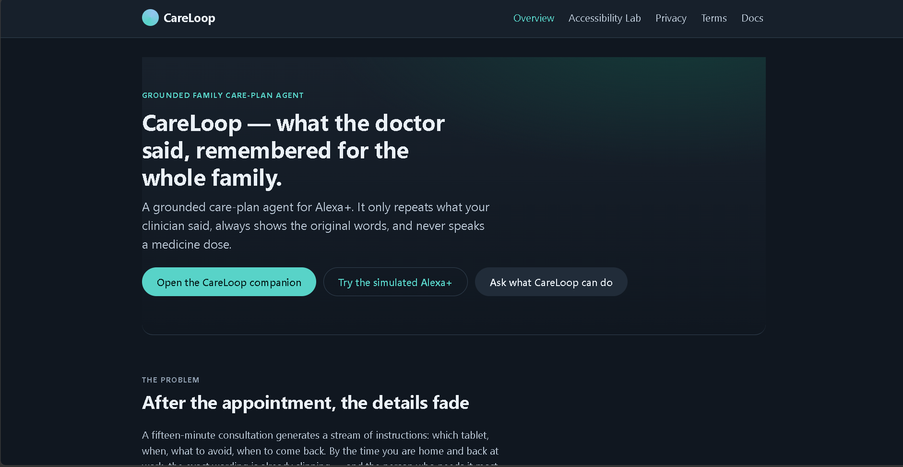
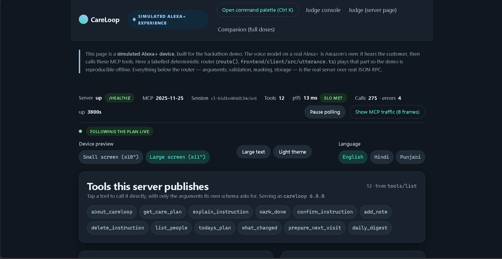
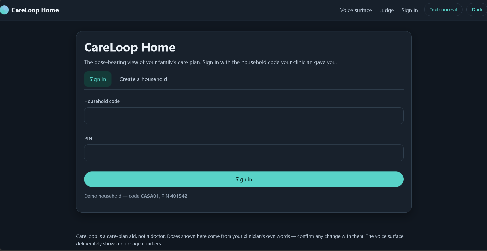

# CareLoop

**Turns a clinician's spoken visit into a grounded care plan that families can ask Alexa+ about, with no invented advice and no spoken doses.**

Entry for the Amazon Developer Hackathon (Alexa+ track + Open Source mini challenge). Adult care plans only; all data is synthetic.

## Core Rules (enforced in code + CI)

- **Extractive by construction:** the model returns only span offsets; every string is a verbatim clinician quote or a fixed constant, and non-verbatim quotes are rejected.
- **Dose-free voice:** every quantity is masked to "your prescribed amount" before speech; full doses appear only on the authenticated companion app. Any leak is a kill criterion, re-checked independently by `preflight/`.

## Key Features

- **MCP server:** 12 tools over Streamable HTTP, with schemas, plain-language errors and generated contracts.
- **Grounded capture:** offline rules engine always runs; optional Bedrock two-pass (extract, then verify).
- **Voice safety:** dose masking, crisis-to-helpline redirect, adult-only gate, prompt-injection refusal.
- **Safe dialogs:** destructive changes are read back and need an explicit yes; ambiguity triggers a question, never a guess.
- **Adaptive delivery:** "slower / louder / softer / shorter" re-speaks the answer with no tool call or write.
- **Speaker scope:** the service decides access from the household boundary (simulated profile, not biometrics).
- **Two devices, one protocol:** browser Device Lab and headless driver, diffed turn by turn.
- **Privacy:** encrypted SQLite per household, hashed transcripts, tamper-evident ledger, crypto-shred receipt.
- **Auth:** OAuth 2.1 with PKCE (S256), RFC 9728 metadata, rotating refresh tokens.
- **Accessibility:** 48 px targets, WCAG-AA contrast, reduced motion, English/Hindi/Punjabi.

## Four Surfaces, One Origin

- `/simulator`: Alexa+ Device Lab.
- `/card`: single self-contained 72.7 kB HTML file.
- `/companion`: Angular app to paste a visit, view full doses, confirm, mark done, export and erase.
- `/judge` and `/`: policy self-test, ledger verify, latency, and docs site.
- All served by one stdlib-only Python process, offline.

## Quickstart

**Docker**

```bash
docker build -t careloop .
docker run --rm -p 127.0.0.1:8080:8080 -v careloop-data:/data careloop
# → http://127.0.0.1:8080/simulator
```

**Local (Python 3.10+, Node 20+)**

```bash
python -m pip install -r requirements.txt && npm install
npm run build && npm run sync
python scripts/serve.py   # http://localhost:8080/simulator
```

- Demo household: `CASA01`, PIN `481542`.
- Secrets are env-only (`CARELOOP_AUTH`, `CARELOOP_DB_ROOT`, `CARELOOP_PUBLIC_URL`, etc.); `.env` is gitignored.

## Verified Results (measured 2026-10-23)

- **Python tests:** 681 passed
- **Frontend tests:** 231 passed across 22 files
- **Eval:** 0.0% hallucination, 0.0% dose leak, 3/3 refusals, F1 0.965
- **Voice eval:** 100% on model's own samples, 0/12 out-of-domain answered (deliberate)
- **Device scenarios:** 10 scenarios, 221 checks, 0 dose leaks
- **Device comparison:** both devices agree, 0 divergences
- **Preflight:** 39 checks, 35 pass, 0 fail, 4 skip
- **Smoke test:** PASS
- **Real published prose:** 142 docs, 2,291 sentences, 0 hallucinations, 0 leaks

## Repo & Licence

- `careloop/` server, `frontend/` (5 workspaces), `alexa/` skill package, `artifacts/`, `tests/`, `preflight/`, `scripts/`, `evidence/`, `Dockerfile`.
- MIT licence; stdlib-only runtime with two optional packages (`cryptography`, `boto3`).
- No web fonts, icon libraries, audio files or third-party brand assets.
## Screenshots






